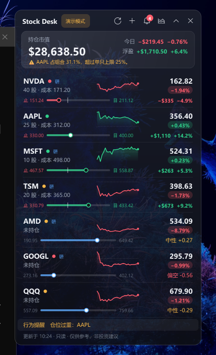
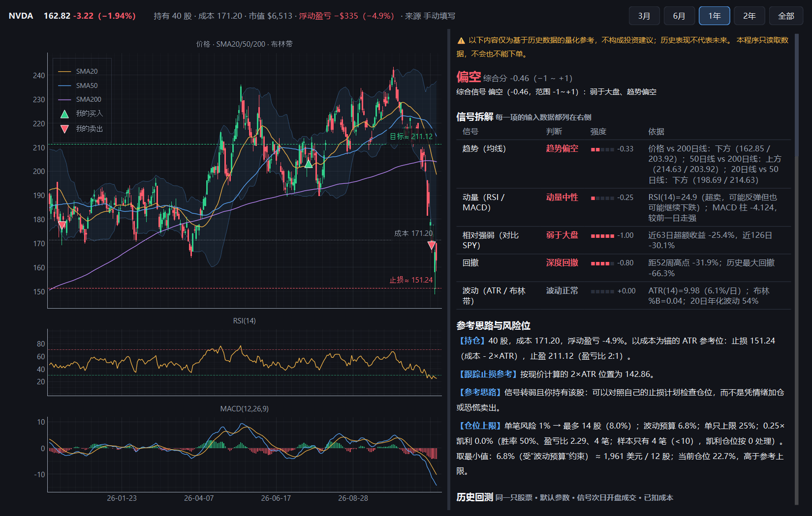

# Stock Desk

**A read-only stock desk for your Windows desktop: watchlist and portfolio widget, explainable quant signals, a Polymarket whale-bet / unusual-options scanner, and e-mail alerts.**

It sits on the edge of your screen, syncs your positions from IBKR or a Robinhood report, and tells you *why* it shows each signal: the inputs, the rule, and how that rule did in a backtest. It cannot trade: there is no order code in the repository, and a test fails the build if any appears.

[中文说明](README.zh-CN.md) · the interface is currently in Chinese





*Screenshots show the built-in demo data.*

## What it does

**On the desktop**

- Translucent, frameless widget that docks to a screen edge and tucks away. Per ticker: price, day change, position, unrealised P&L, sparkline, progress between your stop and target.
- Privacy button: hides quantities, cost and P&L when someone is looking at your screen.
- Click a ticker for candles with SMA / Bollinger / RSI / MACD, your own buys and sells, and the reasoning behind the signal.

**Signals you can check**

- Composite signal from trend, momentum, relative strength vs SPY, drawdown and volatility. Every component is listed with its numbers.
- Seven rule backtests per ticker (next-day-open fills, costs, Wilson interval on the win rate, buy-and-hold next to it), including a range-trading rule that only switches on when the stock is actually moving sideways.
- Volume-confirmed bottoming check: six price conditions and three volume conditions, each shown as pass or fail.
- Support zones, ATR stops, three independent position-size caps, and a portfolio optimiser (risk parity, minimum volatility, maximum Sharpe, mean-variance).

**Unusual-activity scan, every 10 minutes**

- **Polymarket**: large bets (one trade ≥ $50k), one wallet piling into one side, one-sided flow, bets that are large relative to the market's volume, one-hour price jumps. Sports are skipped, and so are 95 %+ "yield" bets, which carry little information.
- **Options**: contracts trading several times their open interest with real premium behind them.
- **Futures**: index, bond, oil, gold and VIX moves beyond two standard deviations.
- Markets that mention a stock on your watchlist are ranked first. Each hit lists the rule it tripped and a short note on how to read it.

**Discipline**

- Behaviour alerts on your own trades: chasing, panic selling, averaging down, revenge trades, oversized positions. Each comes with what happened after your own similar trades in the past.
- Pre-trade check: type the trade you are about to make and run it through the same rules.
- Your own plans: staged buy or trim levels, a target and a floor. You get an alert when the price reaches a level you wrote. A plan can follow another listing's prices (a GDR tracking its home share, for example).
- Daily briefing of what changed since the previous day.

**Alerts when you are away**

- E-mail alerts for bottoming signals, plan levels and strong scan hits, plus a daily signal digest. Mails contain signals only: no holdings, amounts or P&L.
- Optional headless runner for an always-on Linux box (cron). The desktop keeps it in sync and verifies it file by file, so alerts keep coming while the PC sleeps.

## Quick start

Windows 11, Python 3.11 or newer.

```bat
git clone https://github.com/forxhunter/stock-desk
cd stock-desk
setup.bat
StockDesk.bat
```

`setup.bat` creates a local `.venv` and installs the dependencies; nothing is installed globally. The first start is **demo mode**: real Yahoo quotes with sample holdings, no account needed. Edit `watchlist.yaml` with your own tickers, or connect a broker under *分析中心 → 数据源与设置*.

Run the tests with `.venv\Scripts\python.exe -m pytest -q`.

## Data sources

Everything is read-only, and each source is optional.

| Source | Used for | Access |
|---|---|---|
| Yahoo Finance (yfinance) | quotes, history, option chains, futures | no account |
| IBKR Flex Web Service | positions and a year of trades | official; token kept in Windows Credential Manager |
| IBKR TWS / Client Portal | live positions | official; connects in read-only mode, GET requests only |
| Robinhood account-activity report (CSV / XLSX) | trades, rebuilt positions | a file you export yourself, no credentials |
| Polymarket public APIs | odds for your tickers, large-trade scan | no account, no wallet |
| SemiAnalysis RSS | headlines matched to your tickers | public feed only |

## Safety

- **No trading.** No order, bet or transfer code exists, and `tests/test_engine_misc.py` scans the source to keep it that way.
- **Secrets never touch a file on the desktop.** Tokens and the mail authorisation code live in Windows Credential Manager via `keyring`.
- **Your data stays local.** `data/` (cache, settings, logs, imported reports) and `watchlist.yaml` are git-ignored.
- **Not investment advice.** Everything shown is a rule-based statistic on past prices. Past performance says nothing reliable about the future, and the app says so wherever it shows a number.

## Running the alerts on a server

Set `remote.host` in `data/config.yaml` to an ssh host you can log in to with a key, then:

```bat
.venv\Scripts\python.exe scripts\deploy_remote.py
.venv\Scripts\python.exe scripts\push_secrets.py
```

The first command installs the headless runner and a 10-minute cron job. The second moves the mail code and Flex token into a file only your account on that host can read, and makes the server the one that sends mail. `python -m stockdesk.headless digest` prints the daily digest without sending it.

## Limits worth knowing

- The interface is in Chinese. Windows 11 only for the desktop widget; the headless runner works on Linux.
- Yahoo data can be delayed by about 15 minutes and is occasionally rate-limited. Option volume is the day's running total, and it does not show whether the buyer or the seller initiated the trade.
- IBKR Flex and the Robinhood report import have been used against real accounts. The TWS, Client Portal and unofficial Robinhood adapters are covered only by mocked tests.
- The backtests use general default parameters and small samples. A large bet or a volume spike is a reason to look, not a conclusion.

## Configuration

Every threshold is documented in [`config.default.yaml`](config.default.yaml). Override any of them in `data/config.yaml`. The rules of the scan are at the top of [`src/stockdesk/flow.py`](src/stockdesk/flow.py), and those of the bottoming check at the top of [`src/stockdesk/quant/bottom.py`](src/stockdesk/quant/bottom.py).

## Built with

Python, [PySide6](https://doc.qt.io/qtforpython/), [pyqtgraph](https://github.com/pyqtgraph/pyqtgraph), pandas / numpy / scipy, [yfinance](https://github.com/ranaroussi/yfinance), [ib_async](https://github.com/ib-api-reloaded/ib_async), [keyring](https://github.com/jaraco/keyring).
