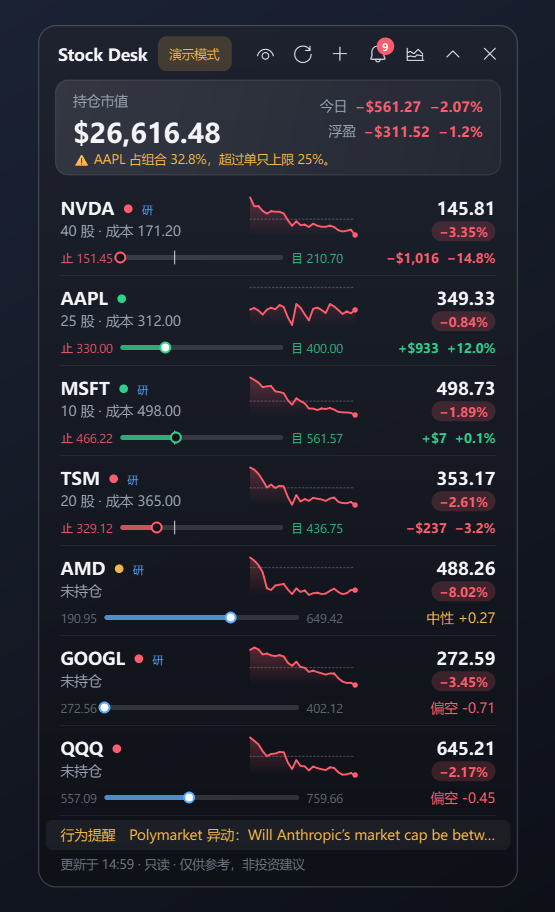
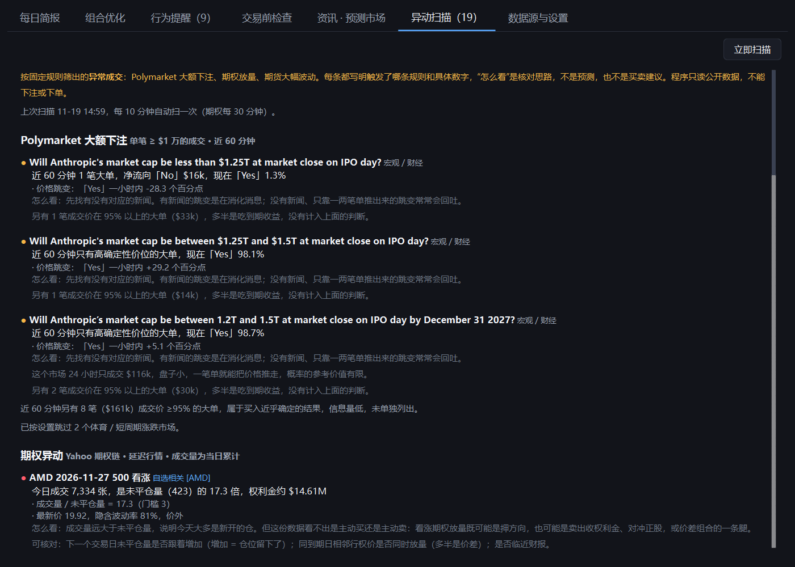
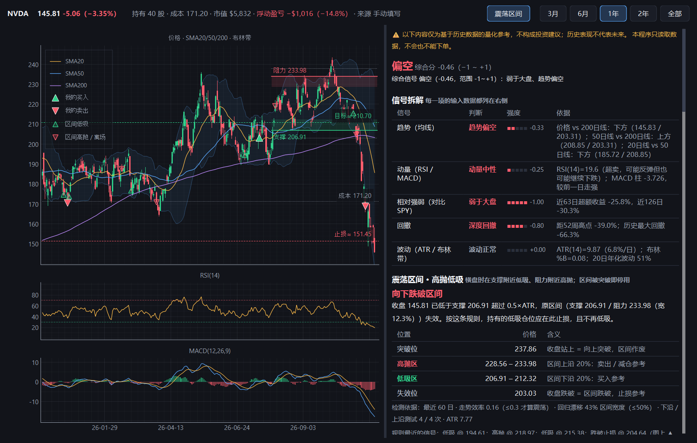
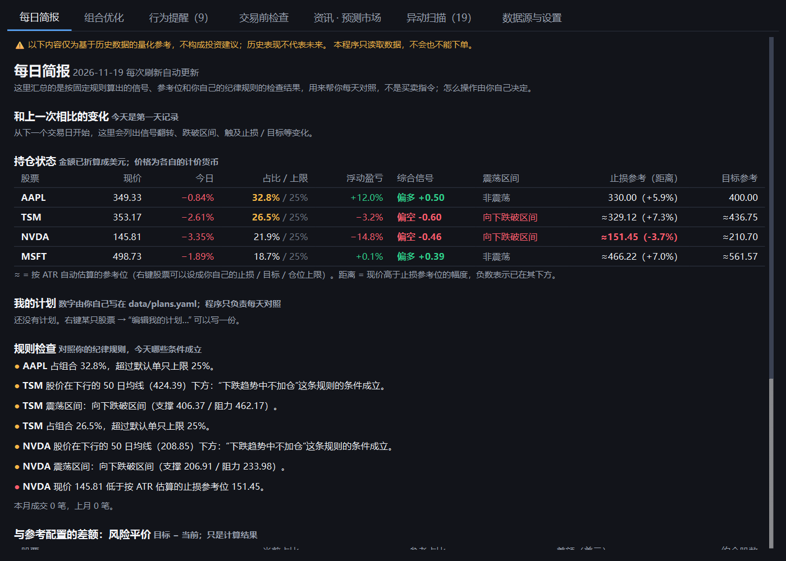

# Stock Desk

Windows 11 桌面股票小组件：同步自选股行情与持仓，给出**带依据的**量化信号、历史回测、组合优化和“追涨杀跌”行为提醒；每 10 分钟扫描 Polymarket 大额下注、期权放量和期货异动；筑底信号、计划价位和强异动可以发邮件，也可以放到一台常开的服务器上跑。

[English](README.md)

> **只读。** 本程序没有任何下单 / 改单 / 撤单代码，也没有开关可以打开它（`tests/test_engine_misc.py` 里有一条测试专门扫描源码保证这一点）。
>
> **不是投资建议。** 所有“建议”都是基于历史价格的统计参考，界面上会同时展示输入数据、推理过程和历史回测，由你自己判断。历史表现不代表未来。









截图里的持仓是程序自带的演示数据，行情和异动扫描是公开的市场数据。

## 快速开始

```bat
git clone https://github.com/forxhunter/stock-desk
cd stock-desk
setup.bat        :: 只需一次：创建本地 .venv 并安装依赖（不会装到全局）
StockDesk.bat    :: 启动（无控制台窗口）；或双击桌面上的 “Stock Desk” 快捷方式
```

- 首次启动是**演示模式**：不需要任何账户，行情是 Yahoo（yfinance）的真实数据，但持仓是 `watchlist.yaml` 里自带的示例数字。把 `watchlist.yaml` 改成你自己的持仓后，角标变成“手动持仓”；在 分析中心 → 数据源 连接 IBKR / 导入 Robinhood CSV 后变成券商名。
- 桌面快捷方式：`powershell -ExecutionPolicy Bypass -File scripts\create_shortcut.ps1`
- 命令行：`.venv\Scripts\python.exe -m stockdesk`；自检截图：`... -m stockdesk --screenshots <目录>`
- 测试：`.venv\Scripts\python.exe -m pytest -q`

界面有中文和英文两种，默认跟随系统语言；可以在 分析中心 → 数据源与设置 里选，或在 `data\config.yaml` 里写 `app.language: zh` / `en`，或用环境变量 `STOCKDESK_LANG`。提醒邮件用同一种语言。改后需重启。

环境：Python 3.13（≥3.11 即可）、Windows 11。日志在 `data\stockdesk.log`。

## 功能

| | |
|---|---|
| **桌面小组件** | 半透明、无边框、可拖动、记住位置、可折叠、托盘图标。每只股票：现价、当日涨跌、持仓数量 / 成本、浮动盈亏、当日走势迷你图、进度条（止损 → 目标；未持仓时显示 52 周区间位置）、综合信号圆点；顶部是组合总市值 / 今日盈亏 / 浮盈；底部轮播预测市场概率、研究文章标题和行为提醒。默认 120 秒自动刷新。 |
| **个股详情**（点击某一行） | K 线 + SMA20/50/200 + 布林带 + 止损 / 目标 / 成本线 + 你自己的买卖点 + 可开关的震荡区间（支撑 / 阻力 / 低吸区 / 高抛区）；RSI、MACD 副图；右侧是信号拆解、震荡区间状态、风险位、仓位上限、7 条规则的历史回测、相关文章和预测市场、局限说明。 |
| **分析中心**（小组件右上角图标 / 托盘菜单） | 组合优化 · 行为提醒 · 交易前检查 · 资讯与预测市场 · 数据源与设置 |
| **每日简报**（分析中心第一页） | 每次刷新自动更新：持仓状态（占比 / 上限、综合信号、震荡区间、止损与目标参考位）、和上一个记录日相比的变化、纪律规则检查（超上限、下行均线下方、急跌超卖、卖出冷静期）、与风险平价参考配置的差额。只是信号与检查结果，不是买卖指令。参数在 `briefing` 下。 |
| **隐私模式** | 小组件顶部的眼睛图标（或右键菜单）：隐藏持仓数量、成本、金额、盈亏和各分析页，只留公开行情；状态会记住。 |
| **非美股** | `market.symbol_map` 把券商代码映射到 Yahoo 代码（如 `HY9H: HY9H.F`）；非美元持仓按 `XXXUSD=X` 汇率折算成美元后计入市值和占比。 |
| **异动扫描** | 每 10 分钟一轮：Polymarket 大额下注（单笔 ≥ $5 万、同一钱包集中下注、单边资金、相对成交异常、一小时价格跳变；跳过体育市场和 95% 以上的“吃息单”）、期权成交量远大于未平仓量的合约、期货与 VIX 超过 2 倍标准差的波动。和自选股有关的排在最前，每条写明触发的规则和核对思路。参数在 `flow` 下。 |
| **筑底检查** | 6 项价格条件 + 3 项成交量条件，逐项显示是否成立；达到门槛才提醒。参数在 `alerts.bottoming` 下。 |
| **我的计划** | 自己写分批买入 / 减仓价位、目标价和底线，价格到了你写的价位就提醒；计划可以跟随另一只股票的价格（例如 GDR 跟随本土股票）。 |
| **大盘关键位破位** | 标普 500 和纳斯达克综合指数跌破 50 / 100 / 200 日均线、20 / 60 日收盘低点、回撤 10% / 20% 线、支撑区或你自己设的价位时提醒：盘中先提醒一次，收盘确认再提醒一次。参数在 `alerts.index_levels` 下，可加 `^NDX`、`^SOX` 等指数。 |
| **议员交易** | 读取众议院书记官网站的官方交易申报（参议院的申报在 efdsearch.senate.gov，需要你自己读过并同意该站点的使用协议、在 `congress.senate` 里确认后才会读取），逐笔记录买入 / 卖出、交易日、披露日和金额区间；按“交易日之后股价相对标普”的表现判断每笔方向对不对（买入后跑赢、卖出后跑输算对），给每位议员评级（带样本量门槛和 95% 区间）并加权。评级偏准以上的议员再次申报、或有人买卖你自选里的股票时提醒，并同时给出“披露之后才跟”的结果。参数在 `congress` 下。扫描的纸质申报（约八分之一）无法读取，只计数。按法律这些申报不得用于商业目的、评定信用或募款。 |
| **提醒正文** | 每条提醒都是分节的分析：发生了什么（具体数字）、现在的位置、下方的关键位、历史上同类情况（之后 5 / 10 / 21 / 63 日的涨跌与平时对照、5 日内收复的比例、最差情形）、对每只自选股意味着什么（β、自己的均线位置、最近支撑）、接下来看什么。仍然是信号，不是买卖建议。 |
| **邮件提醒** | 大盘破位、筑底信号、计划价位、高级别异动，外加每日信号汇总。邮件里只有信号，不含持仓数量、金额和盈亏。 |
| **服务器运行** | 可选：把不带界面的版本放到一台常开的 Linux 机器上（cron 每 10 分钟），电脑休眠时照常发提醒；桌面端自动同步并逐文件校验。见 `scripts/deploy_remote.py`、`scripts/push_secrets.py`。 |
| **自选股** | `watchlist.yaml`（可手动编辑）+ 界面里添加 / 移除；券商同步到的持仓会自动并入显示。右键某一行可设置你自己的止损 / 目标 / 最大仓位。 |

### 量化部分是怎么算的

- **信号**（`quant/analysis.py`）：趋势（价格 / 20 / 50 / 200 日均线排列）、动量（Wilder RSI、MACD 柱及其方向）、相对强弱（对比 SPY 的 63 / 126 日超额收益）、回撤（距 52 周高点）、波动（ATR、布林 %B）。各自打 −1~+1 分，按 35/25/20/10/10 加权成综合分；≥0.35 偏多，≤−0.35 偏空。综合分**不是概率**。
- **风险位与仓位**（`quant/risk.py`）：ATR 止损（入场 − 2×ATR）与 2:1 止盈；三种互相独立的仓位上限取最小值 —— 单笔风险（打到止损最多亏账户 1%）、波动预算（单只贡献约 3% 年化波动）、¼ 凯利（上限 15%；回测少于 10 笔交易或期望为负时按 0 处理）；外加单只 25%、前三 60% 的集中度警告。
- **组合优化**（`quant/optimizer.py`，自己实现，scipy SLSQP）：风险平价、最小波动、最大夏普、均值-方差；只做多、单只上限 35%；协方差用 Ledoit-Wolf 收缩，预期收益向截面均值收缩 50%。给出相对当前持仓的再平衡差额（金额与约合股数）。
- **震荡区间高抛低吸**（`quant/range_trading.py`）：用最近 60 日（不含当天）测量区间，支撑 / 阻力 = 低点 10% 分位 / 高点 90% 分位；只有当宽度在 3~12×ATR 且 ≥3%、走势效率比 ≤0.30、回归漂移 ≤ 区间宽度 50%、上下沿各被测试 ≥2 次时才认定为横盘。横盘中价格在下沿 20% 为“低吸区”，上沿 20% 为“高抛区”；收盘超出边界 0.5×ATR 即判定突破 / 跌破，区间作废、规则停用（也是止损位）。详情页有“震荡区间”开关，在 K 线上画出支撑 / 阻力、两个区域和规则的历史信号；参数在 `quant.range` 下。
- **回测**（`quant/backtest.py`）：7 条规则（均线 50/200、20/50、MACD、趋势过滤、RSI 超卖反弹、布林下轨反弹、震荡区间高抛低吸），**收盘出信号、次日开盘成交**，单边 10bp 成本，报告交易数、胜率及其 95% Wilson 区间、累计收益、最大回撤、夏普、同期买入持有、前后两段是否一致。参数是通用默认值，没有针对个股调参。测试里有“改动未来数据不得影响过去净值”的防前视检查。
- **关于“收益最大化”**：没有任何方法能可靠地做到。最大夏普 / 均值-方差依赖历史均值，极易过拟合；程序会把这句话写在界面上，并建议优先看风险平价 / 最小波动。能控制的是风险，不是收益。

所有阈值都在 `config.default.yaml` 里有注释；要改就在 `data\config.yaml` 里覆盖同名项。

## 连接券商（全部只读）

结论：**IBKR 有官方免费接口，优先用；Robinhood 没有面向股票账户的官方只读 API**。

### IBKR

| 接口 | 性质 / 费用 | 你需要做什么 | 本程序用到的只读范围 |
|---|---|---|---|
| **TWS API**（TWS 或 IB Gateway）— 推荐 | 官方，免费 | 启动并登录 TWS / IB Gateway → File → Global Configuration → API → Settings：勾选 *Enable ActiveX and Socket Clients*，并勾选 ***Read-Only API***（这样网关本身会拒绝任何下单请求）。端口：TWS 实盘 7496 / 模拟 7497，Gateway 实盘 4001 / 模拟 4002。然后在 分析中心 → 数据源 里启用。 | `ib_async` 以 `readonly=True` 连接（写死，不可配置）；只读取持仓、账户净值 / 现金、当日成交。 |
| **Flex Web Service** — 用于历史成交 | 官方，免费，**天然只读**（只能下载报告） | Client Portal 网页 → Performance & Reports → Flex Queries：新建 Activity Flex Query，勾选 *Open Positions* 和 *Trades*，格式 XML，周期建议 Last 365 Calendar Days；记下 Query ID，并在 Flex Web Service Configuration 里生成 token。在数据源页填入 Query ID 和 token。 | `SendRequest` + `GetStatement` 两个 GET。token 只存 Windows 凭据管理器。默认最多 30 分钟拉一次。 |
| **Client Portal Web API** | 官方，免费；个人账户需在本机运行 Client Portal Gateway（Java），且仅支持 IBKR Pro | 下载并启动网关，在**你自己的浏览器**里登录 `https://localhost:5000`，再在数据源页启用。 | 该接口本身**没有只读权限档位**，所以程序在客户端强制：只发 HTTP GET，且路径必须匹配白名单（`/portfolio/accounts`、`/portfolio/{id}/positions/{n}`、`/portfolio/{id}/ledger`、`/iserver/account/trades`）。 |

建议组合：**TWS API（实时持仓）+ Flex（一年成交历史，行为提醒需要它）**。同一券商只取一个持仓来源（TWS > Client Portal > Flex）和一个成交来源（Flex 优先），避免重复计算。

说明：菜单名称若有出入，以 IBKR 当前界面为准。OAuth 方式目前只对机构账户开放，个人账户不适用。

### Robinhood

- **官方接口现状**：(1) *Crypto Trading API*（API key，仅加密货币）；(2) 2026-05-27 发布的 *Robinhood Agents / Agentic Trading*（通过 MCP 让 AI agent 在专用账户里**交易**股票，仍在逐步开放）。官方帮助页说 agent “can view information from your other Robinhood accounts”，但没有公开的只读权限档位，也没有找到公开的服务器地址 / 接入文档。**因此没有可用于“只读同步股票持仓”的官方 API**；出于“严格只读”的原则，本程序没有接入带交易权限的 Agentic Trading。
- **推荐（官方、零凭据）：账户活动 CSV 导出。** Robinhood → Account → Reports and statements → Reports → 生成 *Account activity* 报告（CSV）→ 在数据源页点“导入 CSV…”（文件放在 `data\imports\robinhood\`）。程序从成交记录按平均成本法重建持仓，所以报告要覆盖开户以来的全部历史才准确；需要你定期重新导出。
- **可选（非官方，默认关闭）：`robin_stocks`。** 它调用 Robinhood App 的私有接口，**不是官方 API，可能违反 Robinhood 服务条款，极端情况下账户可能被限制，接口也随时可能失效**。是否启用由你决定；启用时界面会再次确认。程序只通过白名单代理调用它的只读函数（`login`、`get_open_stock_positions`、`get_symbol_by_url`、`get_all_stock_orders`、`load_account_profile`），其它函数（包括所有下单函数）在代码层面无法调用。密码存 Windows 凭据管理器；登录时可能需要在手机上批准设备或输入短信验证码（会弹窗询问）。默认不保存会话（`store_session: false`），否则 `robin_stocks` 会在 `~/.tokens` 下写一个会话文件。

### 凭据

- 密码 / token 只通过 `keyring` 存入 **Windows 凭据管理器**（服务名 `StockDesk`），不写入任何文件，不写日志；错误信息里出现的 token 会被打码。
- `data\`（缓存、配置、日志、导入的 CSV）和 `watchlist.yaml` 都在 `.gitignore` 里。
- 服务器上没有凭据管理器：只有你自己运行 `scripts/push_secrets.py` 时，密钥才会写到那台机器上仅你的账户可读的文件里。

## 研究与情绪数据（背景信息，不触发建议）

- **SemiAnalysis**（半导体研究网站 semianalysis.com）：只读取它自己公开的 RSS（`newsletter.semianalysis.com/feed`，备用 `semianalysis.com/feed/`）：标题、日期、摘要、链接。不登录、不绕过付费墙、不抓取网页；两个站点的 robots.txt 都未禁止 `/feed`。默认最多每小时请求一次，支持条件请求（ETag / Last-Modified）。文章与自选股的匹配规则：标题 / 摘要里出现公司名或代码，或公开 feed 正文里出现 ≥3 次（正文只在内存里扫描，不保存、不显示）。公司别名表在配置的 `aliases` 里，可追加。
- **Polymarket**：只用无需认证的公开 GET 接口 —— Gamma API `public-search`（按关键词找市场）、`markets?slug=`（固定市场）、CLOB `prices-history`（近一月走势）。显示概率、1 日 / 1 周 / 1 月变化、24h 与总成交额。没有钱包、账户、API key，也没有任何下注 / 交易功能。在 `data\config.yaml` 的 `research.polymarket.keywords` / `slugs` 里固定你关心的主题（可带 `tickers` 把它挂到个股详情页）；`auto_ticker_search` 会按自选股公司名自动搜索，嫌吵可以关掉。成交额很小的市场价格没有参考意义，默认过滤掉总成交 < $10k 或 24h 成交 < $100 的市场。

## 行为提醒（追涨杀跌等）

数据来源：券商同步的成交与持仓（只读）、自选股的增删记录、你在程序里设的止损 / 目标 / 仓位上限、日线行情。

| 提醒 | 触发条件（默认阈值，均可配置） |
|---|---|
| 追涨 | 买入当日：5 日涨幅 ≥10%、RSI ≥70、高于 20 日均线 ≥8% 三项中满足两项（或 5 日涨幅 ≥15%） |
| 急涨后才加自选 | 加入自选时该股 5 日已涨 ≥10% |
| 杀跌 | 卖出当日：5 日跌幅 ≥10%、RSI ≤30、距 20 日低点 ≤3% 三项中满足两项（或 5 日跌幅 ≥15%） |
| 处置效应 | 已平仓交易中，亏损单平均持有天数 ≥ 盈利单的 1.5 倍（各至少 3 笔，FIFO 配对） |
| 下跌中连续加仓 | 30 天内连续 ≥3 次、一次比一次低的买入，且股价在下行的 50 日均线下方 |
| 交易过频 / 报复性交易 | 7 天内成交 >12 笔；亏损 ≥5% 的卖出后 24 小时内再次买入 |
| 仓位过重 / 违反自己的计划 | 单只超过上限（你设的或默认 25%）；跌破你设的止损仍持有；到达你设的目标价 |

每条提醒都会用中文说明检测到了什么、当时的数据，以及**你自己过去同类操作之后 20 个交易日的结果**（例如“过去 3 次类似的追涨买入，之后平均 −4.2%，其中 2 次是亏的”）。提醒会弹系统通知，并进入 分析中心 → 行为提醒，可“稍后提醒”（同类型同股票 7 天内不再弹）或关闭。

**重要限制**：程序看不到你还没下的单，所以提醒是在同步之后**事后**发出的。想在下单前检查，请用 **交易前检查**：输入代码 / 方向 / 股数，程序用同一套规则检查这笔假想的交易（追涨 / 杀跌、摊低成本、刚亏损过、买入后仓位占比、按止损计算的单笔风险、是否符合你的计划、是否“卖盈利留亏损”）。它只给出检查结果，不会下单。

没有券商成交记录时，程序会基于真实行情生成几笔带 **【演示数据】** 标记的示例成交来展示这个功能；一旦同步到真实成交，它们会被自动删除（或把 `behavior.demo_sample_trades` 设为 `false`）。

技术选型：Python + **PySide6**（Qt 的逐像素透明无边框窗口在 Windows 11 上是真透明，自绘界面）+ **pyqtgraph**（图表）+ pandas / numpy / scipy。没用 Electron / Tauri，是因为量化和券商生态都在 Python，单进程更简单。

## 离线与限流

行情、文章、预测市场、券商持仓都缓存在 `data\stockdesk.sqlite`。断网或数据源出错时显示上次的数据并在小组件底部提示；Yahoo 限流时自动退避 10 分钟；每次刷新对 Yahoo 最多 2 个批量请求。任何一个数据源失败都不会影响其它数据源。

## 参考的开源项目

通过 pip 依赖使用（未复制代码）：

| 项目 | 许可证 | 用途 |
|---|---|---|
| [ib_async](https://github.com/ib-api-reloaded/ib_async)（ib_insync 的后继） | BSD | IBKR TWS API 客户端；Flex 流程参考了它的 `flexreport.py` 后自行实现 |
| [robin_stocks](https://github.com/jmfernandes/robin_stocks) | MIT | 可选的非官方 Robinhood 读取 |
| [yfinance](https://github.com/ranaroussi/yfinance) | Apache-2.0 | 免费行情 |
| [PySide6](https://doc.qt.io/qtforpython/) | LGPL-3.0 | GUI（动态链接使用） |
| [pyqtgraph](https://github.com/pyqtgraph/pyqtgraph) | MIT | 图表 |
| pandas / numpy / scipy | BSD-3-Clause | 数值计算 |
| [keyring](https://github.com/jaraco/keyring) / PyYAML | MIT | 凭据 / 配置 |
| [ta](https://github.com/bukosabino/ta)（仅测试） | MIT | 指标数值交叉验证 |

只参考思路、未使用代码也未作为依赖：

| 项目 | 许可证 | 参考了什么 |
|---|---|---|
| [PyPortfolioOpt](https://github.com/robertmartin8/PyPortfolioOpt) | MIT | 优化目标的组织方式、协方差收缩、“预期收益不可靠”的提醒。为避免引入 cvxpy 等重依赖，自己用 scipy 实现 |
| [vectorbt](https://github.com/polakowo/vectorbt) | Apache-2.0 + Commons Clause | 向量化回测、信号平移避免前视 |
| [backtrader](https://github.com/mementum/backtrader) | GPL-3.0 | 次日开盘成交、佣金 / 滑点模型的约定（GPL，故不引入） |
| [OpenBB](https://github.com/OpenBB-finance/OpenBB) | AGPL-3.0 | 数据源适配器分层（AGPL，故不引入） |
| [ghostfolio](https://github.com/ghostfolio/ghostfolio) | AGPL-3.0 | 组合总览应展示的指标（AGPL，故不引入） |
| [MiniStocks](https://github.com/Dakostu/MiniStocks)、[YapStocks](https://github.com/librehat/yapstocks) | 见各仓库 | 桌面行情小组件的信息密度；没有找到同时具备半透明 + 持仓 + 量化分析的现成项目 |

## 已知限制

1. 桌面小组件只支持 Windows 11，不带界面的版本可在 Linux 上运行。`config.default.yaml` 里的注释是中文。
2. IBKR Flex 和 Robinhood 报告导入用真实账户跑过；TWS、Client Portal 和非官方 Robinhood 方式只用模拟对象测试过，第一次接入时请看一眼 `data\stockdesk.log`。
3. 行情来自 Yahoo 免费数据：可能延迟约 15 分钟，无盘前盘后，偶尔限流。期权成交量是当日累计，看不出主动买卖方向。
4. 期权、期货、加密货币持仓会被忽略。
5. 窗口没有做毛玻璃模糊，用的是纯透明度（可在设置里调）。
6. 涨跌颜色默认绿涨红跌，可在设置里改成红涨绿跌。
7. Robinhood 报告要覆盖开户以来的全部历史，重建出的持仓才准确；拆股只做了简单处理。
8. Polymarket 自动匹配的市场有时相关性不高；可关闭 `auto_ticker_search`，只保留自己固定的关键词。
9. 行为提醒和异动扫描的阈值是经验值，不是研究结论；回测和“过去同类操作的结果”样本通常很少。大单和放量是“值得看一眼”的线索，不是结论。

## 许可证

[MIT](LICENSE)
